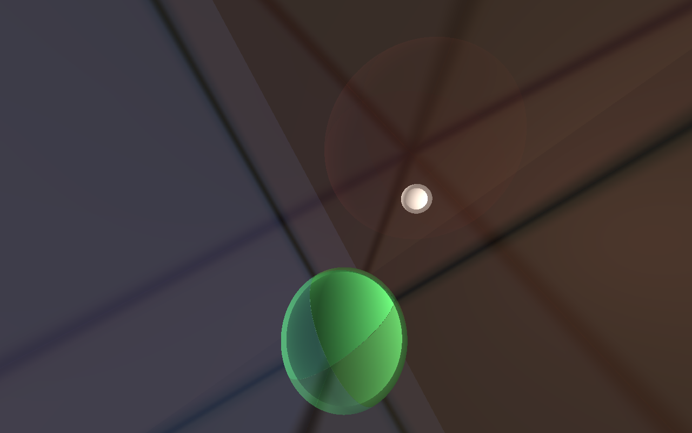

# 3-Sphere Viewer

三维球面 **S³** 内的第一人称视角模拟器。想象一个生活在三维球面空间（而非欧氏空间）中的三维生物：它会看到什么？这个程序用 C++ + OpenGL 实时渲染了答案。



## 效果

- 摄像机始终位于单位三维球面 S³ = {x ∈ ℝ⁴ : |x| = 1} 上，移动严格沿测地线（大圆），姿态随平行输运变化
- 每个物体都有**两个镜像**：顺着短弧看到的近像，以及光绕整个大圆（2π）走"远路"抵达的远像——它出现在**相反的方向**。向后看，你能看到前方月亮绕回来的暗红色远像
- 所有视线在 t = π 处汇聚于视点的对跖点：当 Polaris 月亮恰好位于你的对跖点时，它会充满整个天空
- 场景是 S³ 的正四面体蜂窝 {3,3,4}（16 个球形房间，墙是 4 个大球面 xᵢ = 0），沿直线一直走，穿过 16 个房间后会回到原地

## 数学原理

每像素沿过视点 p、方向 v 的完整测地线求交：

```
γ(t) = cos(t)·p + sin(t)·v,   t ∈ (0, 2π)
```

- 房间墙：大球面 xᵢ = 0，由 `pᵢ·cos t + vᵢ·sin t = 0` 解析求解（零点每隔 π 出现一次）
- 月亮：测地球 `h·c ≥ cos r`，表面交点为 `φ ± θ₀ + 2πk`，其中 `φ = atan2(v·c, p·c)`、`θ₀ = acos(cos r / √((p·c)² + (v·c)²))`
- 半透明墙体用多重求交累积混合（最多 10 层），所有交点统一从原始射线计算，保证大圆在各层之间不弯折
- 移动：`p' = cos s·p + sin s·d`；切标架平行输运 `b' = b⊥ + (b·d)(cos s·d − sin s·p)`

## 构建

依赖：MinGW-w64 g++、[vcpkg](https://github.com/microsoft/vcpkg) 中的 `glfw3` 与 `glad`（x64-mingw-static 三元组）。

```
vcpkg install glfw3:x64-mingw-static glad:x64-mingw-static
build.bat
```

## 操作

| 按键 | 功能 |
|------|------|
| W / S | 沿视线前进 / 后退 |
| A / D | 左 / 右平移 |
| R / F | 上 / 下移动 |
| Q / E | 逆时针 / 顺时针滚转 |
| 鼠标拖拽 | 视角转动（偏航 / 俯仰） |
| Shift | 加速移动 |
| M | 循环墙体透明度（半透明 → 隐形 → 近不透明） |
| T | 复位视角 |
| Esc | 退出 |

窗口标题实时显示眼点坐标与所在房间（四元组符号）。

## 隐藏测试选项

- `s3_viewer.exe --shot`：渲染一帧并保存 `shot.bmp`
- `s3_viewer.exe --shot --nowalls`：同上但墙体全透明（便于观察远像）
- `s3_viewer.exe --shot --test N`：预设视角截图
- `s3_viewer.exe --shot --bench`：离屏帧率测试
